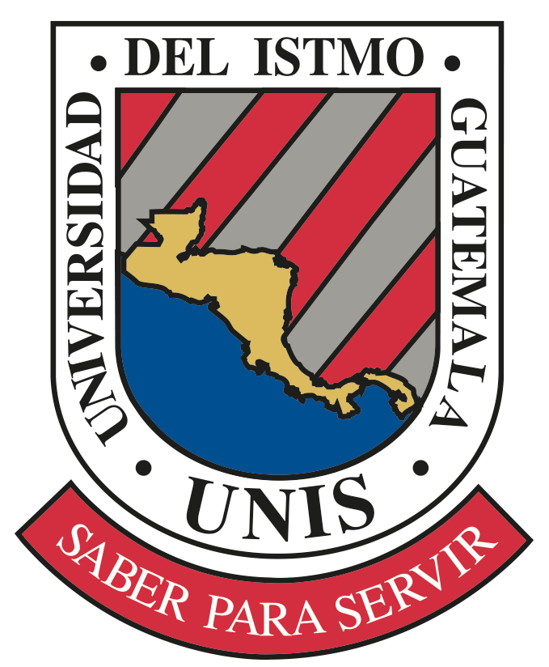
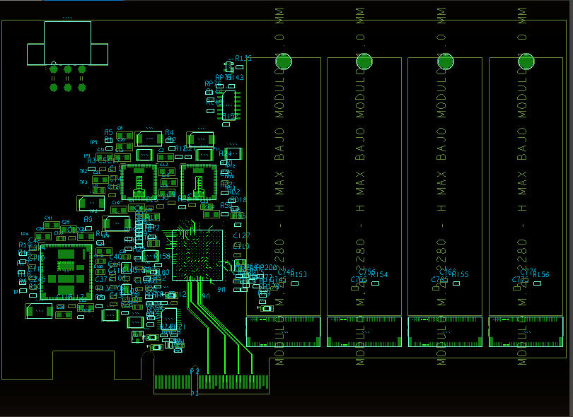
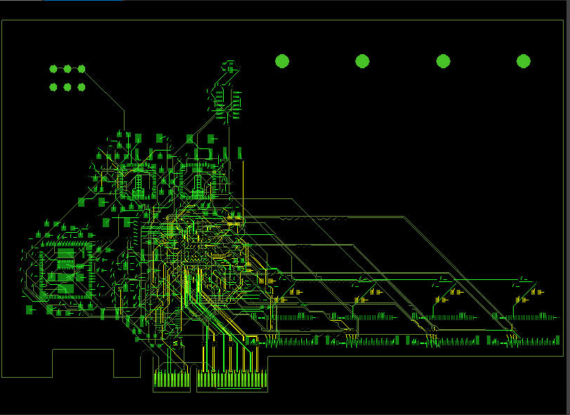
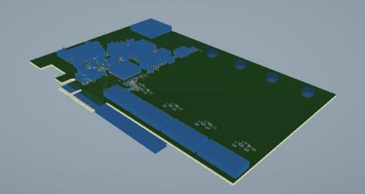
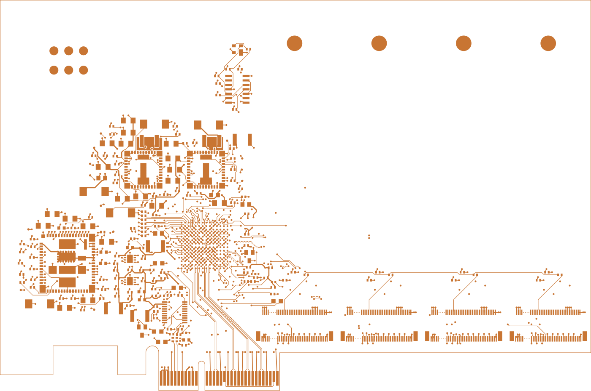

# Universidad del Istmo de Guatemala
### Facultad de Ingeniería

## Proyecto Final
# Switch PCIe Gen3 x4 a cuatro SSD NVMe M.2

| | |
|---|---|
| **Estudiante** | José Rodrigo Quiroa Dávila |
| **Carné** | 17719 |
| **Curso** | Electrónica 2 y Diseño Electrónico |
| **Catedrático** | Víctor Vargas |

Guatemala, noviembre de 2026

---

## Descripción

Tarjeta PCIe que se conecta a un slot x4 y reparte el enlace a cuatro SSD NVMe M.2 (M-key, 2280) usando el switch PCIe Gen3 PI7C9X3G808GP de Diodes/Pericom. El esquemático se capturó a partir del EVB del fabricante (PI7C9X3G808GPA_EVB_V1_0), dejando solo la parte de alta velocidad y quitando lo que se indicó:

- Sin U12, U13 y U16: los gold fingers x4 van directo a U6 (switch).
- Sin S1, S2 y S3.
- Sin U14, U15 y U17: L4 a S4, L5 a S5, L6 a S6 y L7 a S7 van directo a los conectores M.2.

Datos generales de la tarjeta:

- Upstream PCIe Gen3 x4 (gold fingers) y cuatro puertos downstream x1, uno por cada M.2 (J44 a J47).
- Alimentación desde el slot: 12 V y 3.3 V. Reguladores para 3.3 V, 1.8 V y 0.95 V.
- PCB de 6 capas: TOP, GND, señal, señal, 3.3 V y BOTTOM.
- Pares diferenciales a 85 Ω.

## Archivos

| Carpeta | Contenido |
|---|---|
| `esquematico/` | Proyecto de OrCAD Capture (`.opj`, `.DSN`), esquemático en PDF (14 hojas) y BOM (`.csv`) |
| `layout/` | Tarjeta de Allegro (`.brd`) y footprints (`footprints/`: `.dra`, `.psm`, `.pad`) |
| `fabricacion/` | Gerbers (`.art`), taladros (`.drl`), `LEEME.txt` con el orden de capas, todo junto en `.zip` y una vista en PDF de los Gerbers |

## Imágenes

**Colocación de componentes (TOP)**

**Ruteo**

**Vista 3D**

**Gerber TOP**

